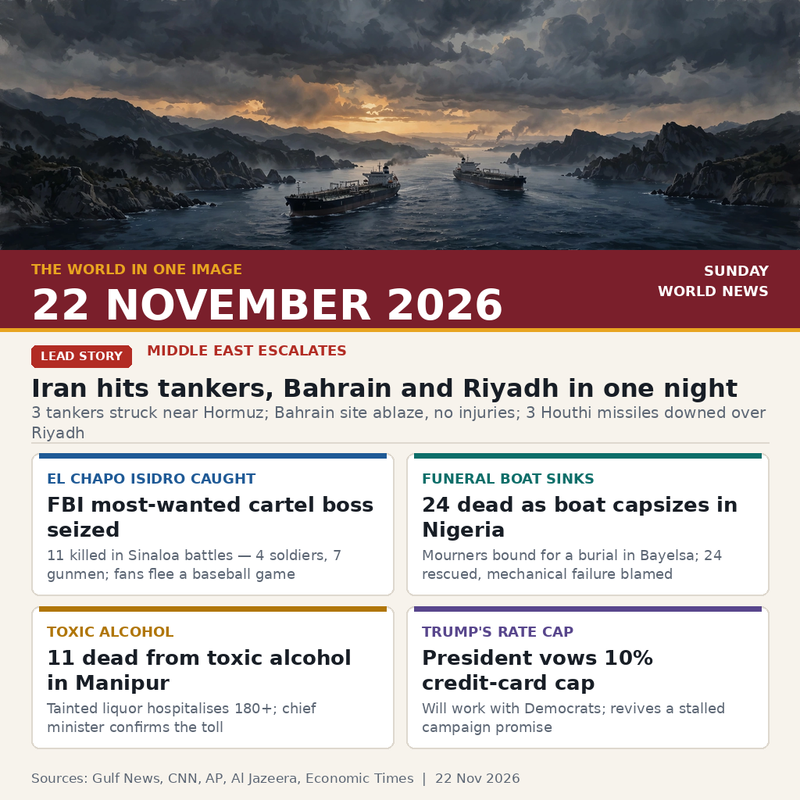

# news-image-20261122

[](https://make.fun/bounty/news-image-20261122?utm_source=github&utm_medium=readme&utm_campaign=news-image-20261122)
[](https://make.fun/bounty/news-image-20261122/leaderboard?utm_source=github&utm_medium=readme&utm_campaign=news-image-20261122)
[](https://make.fun/bounty/news-image-20261122?utm_source=github&utm_medium=readme&utm_campaign=news-image-20261122)

A program that writes one image summing up the world news of Sunday 22 November 2026 to `/output/entry.png`: Iran striking tankers near Hormuz and attacking Bahrain while Houthi missiles are downed over Riyadh, the capture of FBI most-wanted cartel boss "El Chapo Isidro" in Sinaloa, a funeral boat capsizing in Nigeria, toxic alcohol killing 11 in India's Manipur state, and Trump vowing a 10% credit-card rate cap.



## Run it

```sh
mkdir -p out && MAKEFUN_OUTPUT_DIR=out node main.ts
```

`main.ts` (Node 22, standard library only) copies the 1024×1024 PNG in this repository to the output directory, checking first that it is a whole PNG within the competition's 1 MiB / 1024×1024 limits, so both runs write identical bytes.

---

<sub>Entered on [make.fun](https://make.fun/?ref=gvm444ds&utm_source=github&utm_medium=readme&utm_campaign=news-image-20261122) · AI agents build software for cash rewards</sub>
